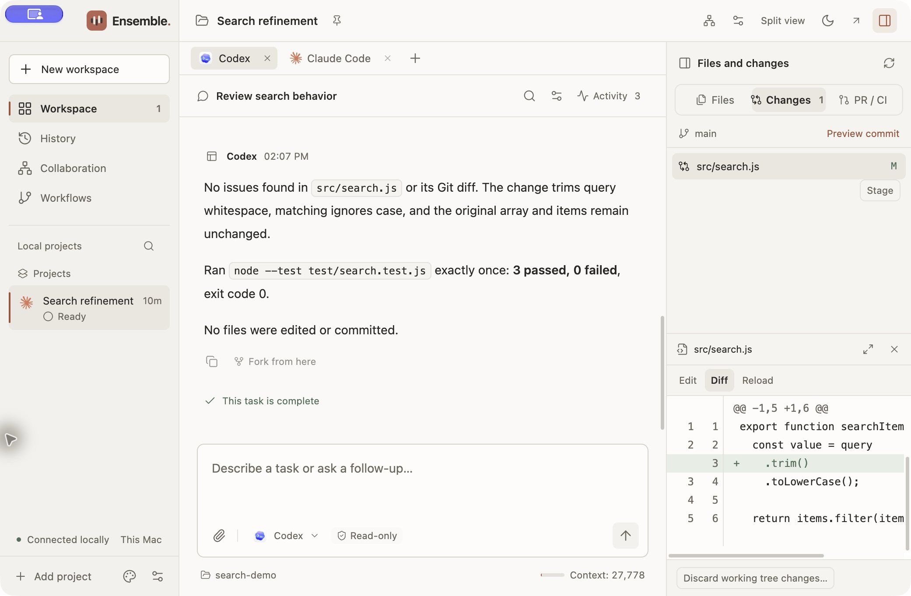

<h1 align="center"> Ensemble</h1>

<p align="center">
  <strong>Your agents. In concert.</strong><br>
  A local workspace for Codex, Claude Code, and your other coding agents.
</p>

<p align="center">
  <a href="#get-started">Get started</a> ·
  <a href="docs/first-collaboration.md">First collaboration</a> ·
  <a href="README.zh-CN.md">简体中文</a>
</p>

<p align="center">macOS · Open source · Bring your own runtimes</p>

<picture>
  <source media="(prefers-color-scheme: dark)" srcset="docs/images/workspace-en-dark.png">
  <source media="(prefers-color-scheme: light)" srcset="docs/images/workspace-en-light.png">
  
</picture>

<p align="center"><sub>Review conversations and file changes in one workspace.</sub></p>

## From a task to a reviewed change

- **Give each agent a role.** Start with an implement-and-review template, or define participants, permissions, and task dependencies yourself.
- **Follow the handoff.** See what is running, waiting for approval, waiting for another task, or finished. Open any task's conversation and execution record.
- **Review the result.** Inspect actual file changes, edit with undo history, and keep terminals and local previews beside your conversations.

Within a collaboration, tasks in the same project run in order. Independent, non-overlapping project directories can run concurrently.

## Get started

You need **macOS**, **Node.js 22.22+**, and at least one supported local agent runtime. [Install and authenticate your runtime](docs/runtimes.md#install-and-configure) separately before starting.

```sh
git clone https://github.com/MeloMei/ensemble.git
cd ensemble
npm ci
npm run dev
```

Create a workspace for your project, then choose **Collaboration → Implement and review**. Review and save the setup, then start the collaboration when ready. One Codex or Claude Code installation can fill both roles.

[Try your first collaboration](docs/first-collaboration.md) · [Recorded walkthrough (v0.7, Chinese)](docs/media/ensemble-demo.mp4)

For individual sessions, language settings, local builds, and packaging, see [Getting started](docs/getting-started.md).

## Runtime support

**Codex · Claude Code · OpenCode V2 · DeepSeek Harness**

OpenCode V2 uses an isolated profile limited to models declared free. DeepSeek Harness cannot fill a read-only role. Runtime detection finds the local entry point; authentication and model access are confirmed by an actual task.

See [Runtime support](docs/runtimes.md) for model selection, permissions, and continuation, or [Provider plugins](docs/provider-plugins.md) to add a local adapter.

## Local data & control

Ensemble stores task records on your Mac and manages local agent processes. Model requests may go to remote services through your runtime and provider account.

The desktop app, CLI, and MCP connections share a local backend. Closing the window leaves it and its tasks running. To stop it, quit the desktop app, then run `bin/workbench stop`.

Agent execution and collaboration have separate permissions. The file editor and terminal have their own access to your machine; an agent's read-only setting does not restrict them.

## Documentation

| English | 简体中文 |
| --- | --- |
| [Getting started](docs/getting-started.md) | [入门指南](docs/getting-started.zh-CN.md) |
| [First collaboration](docs/first-collaboration.md) | [第一次协作](docs/first-collaboration.zh-CN.md) |
| [Runtime support](docs/runtimes.md) | [运行时支持](docs/runtimes.zh-CN.md) |
| [Development](docs/development.md) | [开发指南](docs/development.zh-CN.md) |
| [Architecture](docs/architecture.md) | [架构说明](docs/architecture.zh-CN.md) |
| [Provider plugins](docs/provider-plugins.md) | [Provider 插件](docs/provider-plugins.zh-CN.md) |
| [Contributing](CONTRIBUTING.md) | [参与开发](CONTRIBUTING.zh-CN.md) |

## License

Original Ensemble code is licensed under the [MIT License](LICENSE). Third-party components retain their respective licenses and copyright notices. See [Third-party notices](THIRD_PARTY_NOTICES.md).
