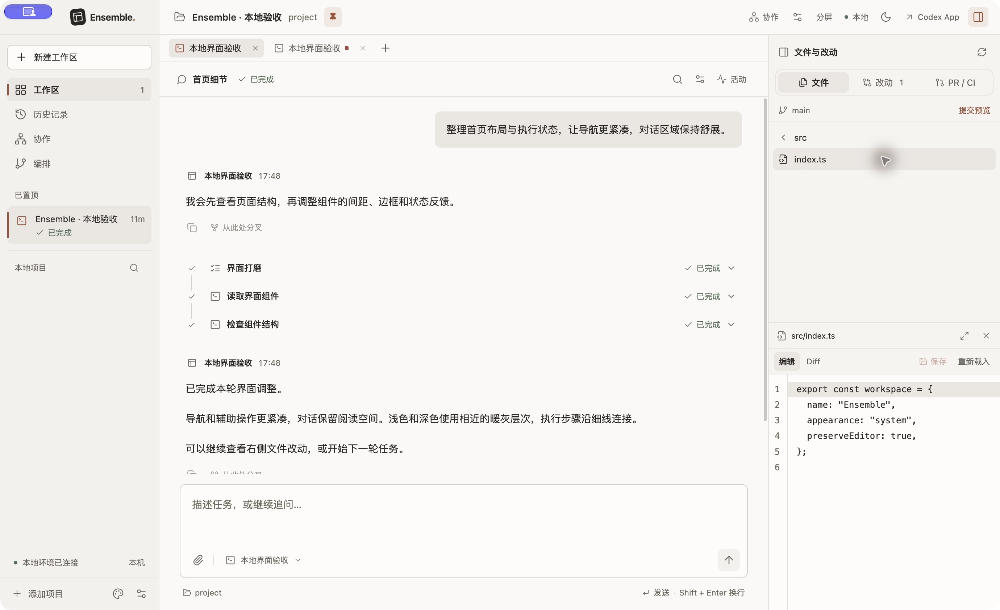
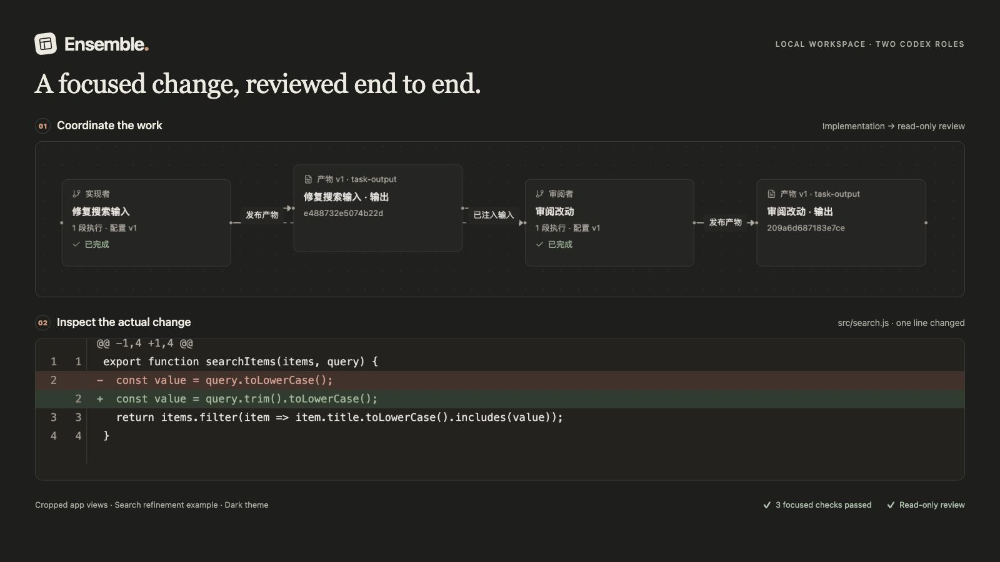
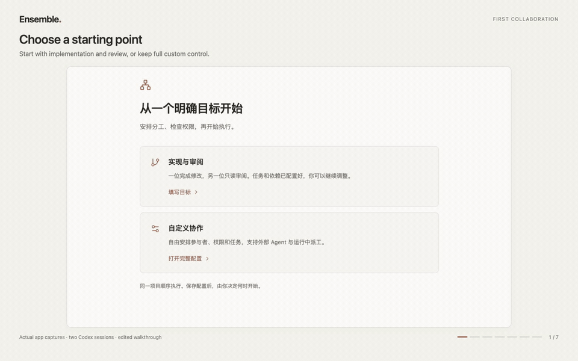

# Ensemble

**让你的 Agent 一起完成工作。**

在同一个本地工作区安排任务、跟踪进展，审阅最终改动。

[查看演示](#查看演示) · [开始使用](#开始使用) · [第一次协作](docs/first-collaboration.zh-CN.md) · [English](README.md)

macOS 桌面应用 · 浅色与深色主题 · 接入你自己的 Agent 运行时



<details>
<summary>深色界面</summary>



</details>

## 从一个任务，到一份经过审阅的改动

- **安排分工。** 从“实现与审阅”模板开始，也可以自己定义参与者、权限和任务依赖。
- **跟踪进展。** 看清哪些任务正在执行、等待审批、等待其他任务或已经结束。需要细节时，打开对应会话和执行记录。
- **检查结果。** 阅读审阅意见、查看实际文件差异，在对话旁编辑文件、使用终端或打开本地预览。

同一个运行时也能分别担任实现者和审阅者。同一协作、同一项目中的任务顺序执行，不重叠的独立项目目录可以并发。自定义协作还支持消息、版本化产物和通过 MCP 接入的外部 Agent。

## 查看演示

[](docs/media/ensemble-demo.mp4)

[打开视频](docs/media/ensemble-demo.mp4) · [动手完成同一个搜索示例](docs/first-collaboration.zh-CN.md)

演示由真实 Ensemble 应用中的关键画面剪辑而成，记录了两个独立 Codex 会话。实现者在本地搜索示例中修改一行代码，并通过对应的局部检查；随后，只读审阅者检查 Diff 和测试文件，复用已有检查结果，没有重复运行检查或修改文件。视频经过剪辑，片长不代表实际执行耗时。

主图和视频录制于 Ensemble 0.7.0，展示的是当时的简体中文界面。

## 开始使用

准备 macOS、Node.js 22.22 或更新版本，以及至少一个受支持的本地 Agent 运行时。运行时需要单独安装并完成认证，入口见[官方安装与配置说明](docs/runtimes.zh-CN.md#安装与配置)。第一次协作可以让同一套 Codex 或 Claude Code 安装分别承担两个角色。

```sh
git clone https://github.com/MeloMei/ensemble.git
cd ensemble
npm ci
npm run dev
```

在 **偏好设置**（Preferences）中，可以选择 **跟随系统**、**简体中文** 或 **English**。首次启动跟随系统语言，选择会保存在本机。已有任务、对话、代码和运行时诊断保留原文。

1. 打开 **接入与插件**，点击 **刷新检测**，查找已安装的运行时。
2. 为项目创建工作区，进入 **协作 → 实现与审阅**。
3. 填写目标、选择运行时，点击 **检查分工**。
4. 检查任务和权限，点击 **保存并查看协作**，准备好后再点 **开始协作**。

“已发现入口”表示找到了本机程序，认证和模型访问以实际任务为准。模型用量沿用运行时配置和你的服务商账户。

构建并运行生产文件：

```sh
npm run build
npm start
```

单 Agent 会话、本地打包和后台控制见[入门指南](docs/getting-started.zh-CN.md)。

## 运行时支持

| 运行时 | Ensemble 中的模型选择 | 只读执行 | 原生续聊 |
| --- | --- | --- | --- |
| Codex | 原生模型目录与 CLI 配置 | 原生只读沙箱 | 支持 |
| Claude Code | CLI 默认配置与已配置的模型映射 | Plan 模式与工具限制 | 支持 |
| OpenCode V2 | 独立配置下，目录声明免费的模型 | Plan 模式与工具限制 | 取决于原生 ACP 能力 |
| DeepSeek Harness | DeepSeek Flash 路由 | 不支持 | 取决于原生 ACP 能力 |

OpenCode V2 使用独立配置，不沿用个人 Provider 设置。DeepSeek Harness 不能担任只读审阅者。原生能力和模型可用性取决于已安装的运行时，完整说明见[运行时支持](docs/runtimes.zh-CN.md)。新增本地适配器见 [Provider 插件](docs/provider-plugins.zh-CN.md)。

## 项目与执行由你控制

Ensemble 在本机保存任务记录并管理 Agent 进程。你选择的运行时可能向远端模型服务发送请求。项目目录、模型和权限由你在执行前确定。

未发送的会话文字和附件会保存为草稿。关闭窗口时，应用会等待尚未完成的草稿保存；无法确认保存结果时，会让你选择是否保留窗口。

桌面应用、CLI 和 MCP 连接共用一个本地后台。关闭窗口后，后台和任务会继续运行。需要停止时，先退出桌面应用，再执行 `bin/workbench stop`。

运行时权限和协作权限控制不同操作。文件编辑器和终端拥有各自的本机访问能力，Agent 的只读设置不会限制它们。

## 文档

| 内容 | English | 简体中文 |
| --- | --- | --- |
| 安装与首个会话 | [Getting started](docs/getting-started.md) | [入门指南](docs/getting-started.zh-CN.md) |
| 实现、审阅与检查改动 | [First collaboration](docs/first-collaboration.md) | [第一次协作](docs/first-collaboration.zh-CN.md) |
| 运行时行为与边界 | [Runtime support](docs/runtimes.md) | [运行时支持](docs/runtimes.zh-CN.md) |
| 开发与打包 | [Development](docs/development.md) | [开发指南](docs/development.zh-CN.md) |
| 组件与执行流程 | [Architecture](docs/architecture.md) | [架构说明](docs/architecture.zh-CN.md) |
| 本地 Provider 协议 | [Provider plugins](docs/provider-plugins.md) | [Provider 插件](docs/provider-plugins.zh-CN.md) |
| 参与开发 | [Contributing](CONTRIBUTING.md) | [参与开发](CONTRIBUTING.zh-CN.md) |

## 许可证

Ensemble 自有代码采用 [MIT 许可证](LICENSE)。第三方组件继续保留各自的许可证和版权声明，详见[第三方告知](THIRD_PARTY_NOTICES.zh-CN.md)。
