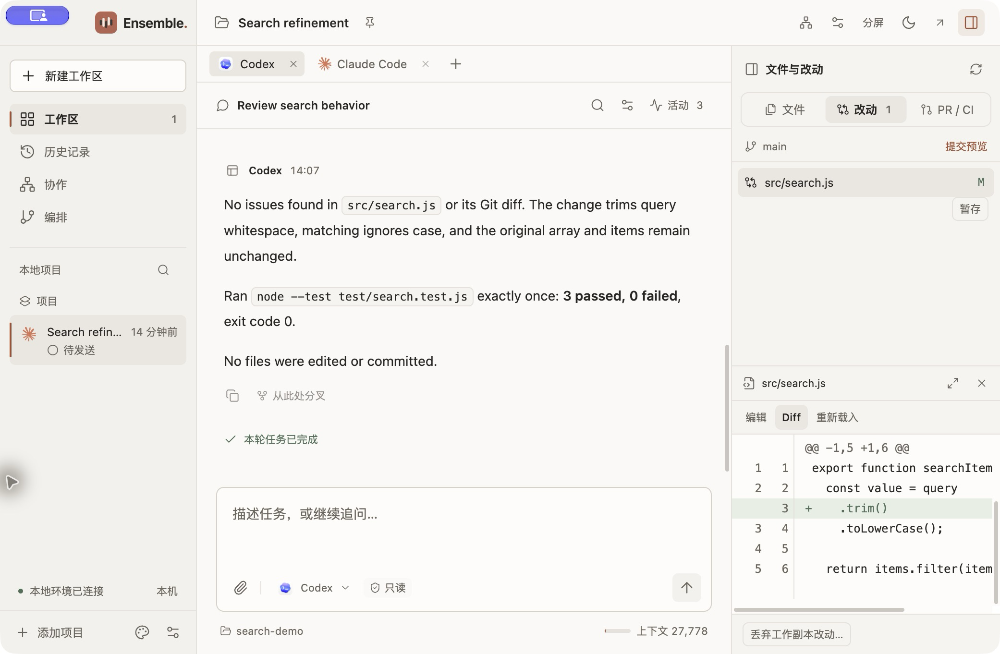

<h1 align="center"> Ensemble</h1>

<p align="center">
  <strong>让你的 Agent 一起完成工作。</strong><br>
  在同一个本地工作区使用 Codex、Claude Code 和其他编程 Agent。
</p>

<p align="center">
  <a href="https://github.com/MeloMei/ensemble/releases/download/v0.8.1/Ensemble-0.8.1-macOS-arm64.dmg">下载 macOS 安装包</a> ·
  <a href="docs/media/ensemble-overview-zh-CN.mp4">观看中文视频 · 30 秒</a> ·
  <a href="docs/first-collaboration.zh-CN.md">第一次协作</a> ·
  <a href="README.md">English</a>
</p>

<p align="center">macOS · Apple Silicon · 开源 · 接入你自己的运行时</p>

## 开始使用

1. **[下载 macOS 安装包（Apple Silicon）](https://github.com/MeloMei/ensemble/releases/download/v0.8.1/Ensemble-0.8.1-macOS-arm64.dmg)。** 打开 DMG，将 `Ensemble.app` 拖入“应用程序”。也可以查看 [ZIP 下载和发布说明](https://github.com/MeloMei/ensemble/releases/latest)。
2. **接入你使用的 Agent 运行时。** [单独安装 Codex、Claude Code 或其他受支持的运行时并完成认证](docs/runtimes.zh-CN.md#安装与配置)，然后打开 Ensemble，在 **接入与插件** 中点击 **刷新检测**。安装包中的桌面应用不要求另装 Node.js；所选运行时的环境要求仍需单独满足。
3. **[动手完成第一次协作](docs/first-collaboration.zh-CN.md)。** 为项目创建工作区，选择 **协作 → 实现与审阅**。检查并保存配置，准备好后再开始协作。同一套 Codex 或 Claude Code 安装就可以分别承担两个角色。

当前版本尚未通过 Apple 公证，macOS 可能拦截首次启动。请先查看[发布说明](https://github.com/MeloMei/ensemble/releases/latest)，再参照 [Apple 官方说明](https://support.apple.com/102445)处理系统提示。

## 用 30 秒了解 Ensemble

[中文视频](docs/media/ensemble-overview-zh-CN.mp4) · [English video](docs/media/ensemble-overview-en.mp4)

视频展示真实界面中的任务交接、Agent 对话、文件改动和运行结果。想亲手试一次，可以跟着[第一次协作教程](docs/first-collaboration.zh-CN.md)操作。

<picture>
  <source media="(prefers-color-scheme: dark)" srcset="docs/images/workspace-zh-dark.png">
  <source media="(prefers-color-scheme: light)" srcset="docs/images/workspace-zh-light.png">
  
</picture>

<p align="center"><sub>在同一个工作区查看审阅对话与文件改动。</sub></p>

## 从一个任务，到一份经过审阅的改动

- **安排分工。** 从“实现与审阅”模板开始，也可以自己定义参与者、权限和任务依赖。
- **跟踪交接。** 看清哪些任务正在执行、等待审批、等待其他任务或已经结束，随时打开对应对话和执行记录。
- **审阅结果。** 查看实际文件差异，编辑文件并保留撤销记录，在对话旁使用终端和本地预览。

同一协作、同一项目中的任务顺序执行。不重叠的独立项目目录可以并发。

## 从源码运行

从源码开发时，除已配置的 Agent 运行时外，还需要 **macOS**、**Node.js 22.22 或更新版本**和 npm。

```sh
git clone https://github.com/MeloMei/ensemble.git
cd ensemble
npm ci
npm run dev
```

单 Agent 会话、语言设置、本地构建和打包见[入门指南](docs/getting-started.zh-CN.md)。

## 运行时支持

**Codex · Claude Code · Pi · OpenCode V2 · DeepSeek Harness**

Pi 需要官方 npm CLI 1.3.0 或更新版本。OpenCode V2 使用独立配置，仅接入目录声明免费的模型。DeepSeek Harness 不能担任只读角色。运行时检测不确认登录和模型访问，需通过实际任务验证。

模型选择、权限与续聊能力见[运行时支持](docs/runtimes.zh-CN.md)。新增本地适配器见 [Provider 插件](docs/provider-plugins.zh-CN.md)。

## 本地数据与操作权限

Ensemble 在 Mac 上保存任务记录并管理本地 Agent 进程。模型请求可能通过你配置的运行时和服务商账户发送到远端服务。

桌面应用、CLI 和 MCP 连接共用一个本地后台。关闭窗口后，后台和任务会继续运行。使用源码版时，可以先退出桌面应用，再在仓库目录执行 `bin/workbench stop` 停止后台。

Agent 执行权限与协作权限分别控制不同操作。文件编辑器和终端拥有各自的本机访问能力，Agent 的只读设置不会限制它们。

## 文档

| English | 简体中文 |
| --- | --- |
| [Getting started](docs/getting-started.md) | [入门指南](docs/getting-started.zh-CN.md) |
| [First collaboration](docs/first-collaboration.md) | [第一次协作](docs/first-collaboration.zh-CN.md) |
| [Runtime support](docs/runtimes.md) | [运行时支持](docs/runtimes.zh-CN.md) |
| [Development](docs/development.md) | [开发指南](docs/development.zh-CN.md) |
| [Architecture](docs/architecture.md) | [架构说明](docs/architecture.zh-CN.md) |
| [Provider plugins](docs/provider-plugins.md) | [Provider 插件](docs/provider-plugins.zh-CN.md) |
| [Contributing](CONTRIBUTING.md) | [参与开发](CONTRIBUTING.zh-CN.md) |

## 许可证

Ensemble 自有代码采用 [MIT 许可证](LICENSE)。第三方组件继续保留各自的许可证和版权声明，详见[第三方告知](THIRD_PARTY_NOTICES.zh-CN.md)。

概览视频配乐为 Arulo 的《Cat Walk》，来自 [Mixkit](https://mixkit.co/free-stock-music/edm/)，按 [Mixkit Stock Music Free License](https://mixkit.co/license/#musicFree) 使用。配乐不适用 Ensemble 的 MIT 许可证。
